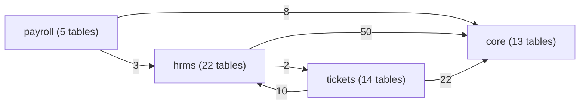
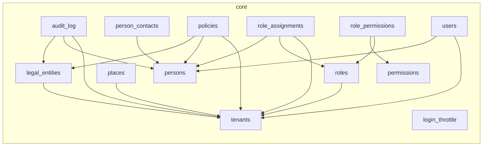
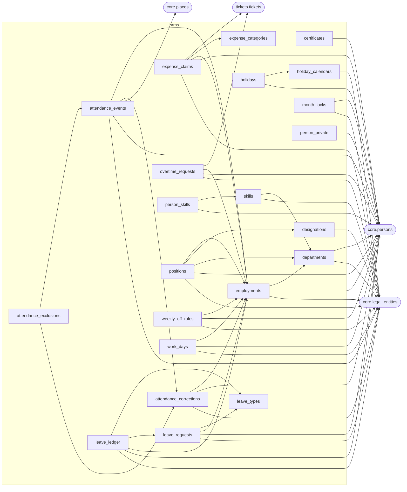
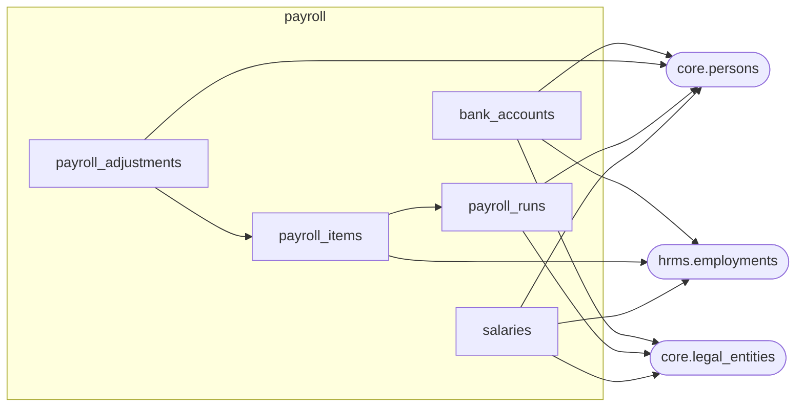
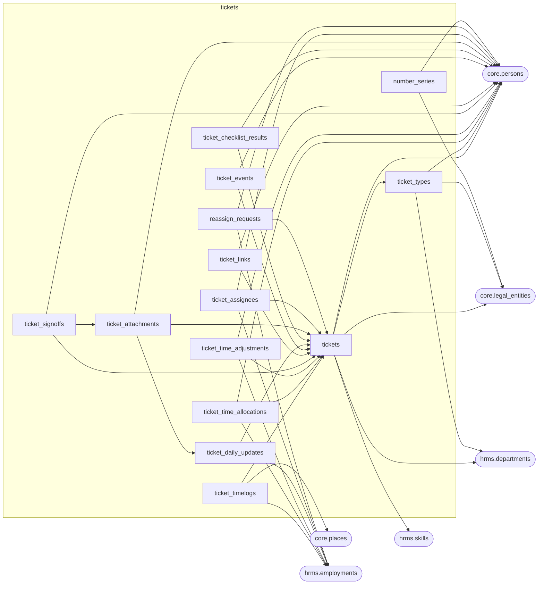

# Ageless platform — how the database connects

Written for backend developers. Generated on 2026-11-06 from the migrated database's catalog. Every table and column is described
in [schemas.md](schemas.md). This page shows how the tables point at each other: the foreign keys, the links between
modules, the company-safe keys, the connections that are not foreign keys, and the triggers that guard the data.

## Contents
- [Modules at a glance](#modules-at-a-glance)
- [Diagrams per schema](#diagrams-per-schema)
- [Links between modules](#links-between-modules)
- [Company-safe foreign keys](#company-safe-foreign-keys)
- [Every foreign key](#every-foreign-key)
- [Per table: points to / pointed at by](#per-table-points-to--pointed-at-by)
- [Connections that are not foreign keys](#connections-that-are-not-foreign-keys)
- [Triggers](#triggers)

## Modules at a glance

Arrows point from the table holding the foreign key to the table it references (number of foreign keys).

Core is the base everything points to (tenants, companies, persons). HRMS builds on core; payroll and tickets build on
core and HRMS (jobs, departments, skills). Two keys point from HRMS into tickets: `hrms.expense_claims.ticket_id` and
`hrms.overtime_requests.ticket_id` (the ticket an expense or overtime was for). They are single-column keys, **not**
company-safe: nothing in the database stops a claim from naming another company’s ticket (see [../security.md](../security.md#known-gaps)).

## Diagrams per schema

### core

Rounded boxes are tables of other schemas. Self-references are listed in the tables below.

### hrms

Rounded boxes are tables of other schemas. Self-references are listed in the tables below.

### payroll

Rounded boxes are tables of other schemas. Self-references are listed in the tables below.

### tickets

Rounded boxes are tables of other schemas. Self-references are listed in the tables below.

## Links between modules

| From (module table) | Columns | To | Columns | Constraint |
| --- | --- | --- | --- | --- |
| `hrms.attendance_corrections` | approver_person_id | `core.persons` | id | `attendance_corrections_approver_person_id_persons_id_fk` |
| `hrms.attendance_corrections` | cancelled_by | `core.persons` | id | `attendance_corrections_cancelled_by_persons_id_fk` |
| `hrms.attendance_corrections` | decided_by | `core.persons` | id | `attendance_corrections_decided_by_persons_id_fk` |
| `hrms.attendance_corrections` | legal_entity_id | `core.legal_entities` | id | `attendance_corrections_legal_entity_id_legal_entities_id_fk` |
| `hrms.attendance_corrections` | person_id | `core.persons` | id | `attendance_corrections_person_id_persons_id_fk` |
| `hrms.attendance_corrections` | requested_by | `core.persons` | id | `attendance_corrections_requested_by_persons_id_fk` |
| `hrms.attendance_events` | legal_entity_id | `core.legal_entities` | id | `attendance_events_legal_entity_id_legal_entities_id_fk` |
| `hrms.attendance_events` | person_id | `core.persons` | id | `attendance_events_person_id_persons_id_fk` |
| `hrms.attendance_events` | place_id | `core.places` | id | `attendance_events_place_id_places_id_fk` |
| `hrms.certificates` | person_id | `core.persons` | id | `certificates_person_id_persons_id_fk` |
| `hrms.certificates` | verified_by | `core.persons` | id | `certificates_verified_by_persons_id_fk` |
| `hrms.departments` | head_person_id | `core.persons` | id | `departments_head_person_id_persons_id_fk` |
| `hrms.departments` | legal_entity_id | `core.legal_entities` | id | `departments_legal_entity_id_legal_entities_id_fk` |
| `hrms.designations` | legal_entity_id | `core.legal_entities` | id | `designations_legal_entity_id_legal_entities_id_fk` |
| `hrms.employments` | legal_entity_id | `core.legal_entities` | id | `employments_legal_entity_id_legal_entities_id_fk` |
| `hrms.employments` | manager_person_id | `core.persons` | id | `employments_manager_person_id_persons_id_fk` |
| `hrms.employments` | person_id | `core.persons` | id | `employments_person_id_persons_id_fk` |
| `hrms.expense_claims` | approved_by | `core.persons` | id | `expense_claims_approved_by_persons_id_fk` |
| `hrms.expense_claims` | legal_entity_id | `core.legal_entities` | id | `expense_claims_legal_entity_id_legal_entities_id_fk` |
| `hrms.expense_claims` | person_id | `core.persons` | id | `expense_claims_person_id_persons_id_fk` |
| `hrms.expense_claims` | rejected_by | `core.persons` | id | `expense_claims_rejected_by_persons_id_fk` |
| `hrms.expense_claims` | ticket_id | `tickets.tickets` | id | `expense_claims_ticket_id_tickets_id_fk` |
| `hrms.holiday_calendars` | legal_entity_id | `core.legal_entities` | id | `holiday_calendars_legal_entity_id_legal_entities_id_fk` |
| `hrms.holidays` | created_by | `core.persons` | id | `holidays_created_by_persons_id_fk` |
| `hrms.leave_ledger` | legal_entity_id | `core.legal_entities` | id | `leave_ledger_legal_entity_id_legal_entities_id_fk` |
| `hrms.leave_ledger` | posted_by | `core.persons` | id | `leave_ledger_posted_by_persons_id_fk` |
| `hrms.leave_requests` | approver_person_id | `core.persons` | id | `leave_requests_approver_person_id_persons_id_fk` |
| `hrms.leave_requests` | cancelled_by | `core.persons` | id | `leave_requests_cancelled_by_persons_id_fk` |
| `hrms.leave_requests` | decided_by | `core.persons` | id | `leave_requests_decided_by_persons_id_fk` |
| `hrms.leave_requests` | legal_entity_id | `core.legal_entities` | id | `leave_requests_legal_entity_id_legal_entities_id_fk` |
| `hrms.leave_requests` | person_id | `core.persons` | id | `leave_requests_person_id_persons_id_fk` |
| `hrms.month_locks` | legal_entity_id | `core.legal_entities` | id | `month_locks_legal_entity_id_legal_entities_id_fk` |
| `hrms.month_locks` | locked_by | `core.persons` | id | `month_locks_locked_by_persons_id_fk` |
| `hrms.month_locks` | unlocked_by | `core.persons` | id | `month_locks_unlocked_by_persons_id_fk` |
| `hrms.overtime_requests` | approver_person_id | `core.persons` | id | `overtime_requests_approver_person_id_persons_id_fk` |
| `hrms.overtime_requests` | cancelled_by | `core.persons` | id | `overtime_requests_cancelled_by_persons_id_fk` |
| `hrms.overtime_requests` | decided_by | `core.persons` | id | `overtime_requests_decided_by_persons_id_fk` |
| `hrms.overtime_requests` | legal_entity_id | `core.legal_entities` | id | `overtime_requests_legal_entity_id_legal_entities_id_fk` |
| `hrms.overtime_requests` | person_id | `core.persons` | id | `overtime_requests_person_id_persons_id_fk` |
| `hrms.overtime_requests` | requested_by | `core.persons` | id | `overtime_requests_requested_by_persons_id_fk` |
| `hrms.overtime_requests` | ticket_id | `tickets.tickets` | id | `overtime_requests_ticket_id_tickets_id_fk` |
| `hrms.person_private` | person_id | `core.persons` | id | `person_private_person_id_persons_id_fk` |
| `hrms.person_private` | updated_by | `core.persons` | id | `person_private_updated_by_persons_id_fk` |
| `hrms.person_skills` | person_id | `core.persons` | id | `person_skills_person_id_persons_id_fk` |
| `hrms.person_skills` | verified_by | `core.persons` | id | `person_skills_verified_by_persons_id_fk` |
| `hrms.positions` | created_by | `core.persons` | id | `positions_created_by_persons_id_fk` |
| `hrms.positions` | legal_entity_id | `core.legal_entities` | id | `positions_legal_entity_id_legal_entities_id_fk` |
| `hrms.skills` | legal_entity_id | `core.legal_entities` | id | `skills_legal_entity_id_legal_entities_id_fk` |
| `hrms.weekly_off_rules` | created_by | `core.persons` | id | `weekly_off_rules_created_by_persons_id_fk` |
| `hrms.weekly_off_rules` | legal_entity_id | `core.legal_entities` | id | `weekly_off_rules_legal_entity_id_legal_entities_id_fk` |
| `hrms.work_days` | legal_entity_id | `core.legal_entities` | id | `work_days_legal_entity_id_legal_entities_id_fk` |
| `hrms.work_days` | person_id | `core.persons` | id | `work_days_person_id_persons_id_fk` |
| `payroll.bank_accounts` | created_by | `core.persons` | id | `bank_accounts_created_by_persons_id_fk` |
| `payroll.bank_accounts` | employment_id, legal_entity_id | `hrms.employments` | id, legal_entity_id | `bank_accounts_employment_company_fk` |
| `payroll.bank_accounts` | legal_entity_id | `core.legal_entities` | id | `bank_accounts_legal_entity_id_legal_entities_id_fk` |
| `payroll.payroll_adjustments` | created_by | `core.persons` | id | `payroll_adjustments_created_by_persons_id_fk` |
| `payroll.payroll_items` | employment_id, legal_entity_id | `hrms.employments` | id, legal_entity_id | `payroll_items_employment_company_fk` |
| `payroll.payroll_runs` | approved_by | `core.persons` | id | `payroll_runs_approved_by_persons_id_fk` |
| `payroll.payroll_runs` | legal_entity_id | `core.legal_entities` | id | `payroll_runs_legal_entity_id_legal_entities_id_fk` |
| `payroll.payroll_runs` | prepared_by | `core.persons` | id | `payroll_runs_prepared_by_persons_id_fk` |
| `payroll.salaries` | created_by | `core.persons` | id | `salaries_created_by_persons_id_fk` |
| `payroll.salaries` | employment_id, legal_entity_id | `hrms.employments` | id, legal_entity_id | `salaries_employment_company_fk` |
| `payroll.salaries` | legal_entity_id | `core.legal_entities` | id | `salaries_legal_entity_id_legal_entities_id_fk` |
| `tickets.number_series` | legal_entity_id | `core.legal_entities` | id | `number_series_legal_entity_id_legal_entities_id_fk` |
| `tickets.number_series` | updated_by | `core.persons` | id | `number_series_updated_by_persons_id_fk` |
| `tickets.reassign_requests` | approver_person_id | `core.persons` | id | `reassign_requests_approver_person_id_persons_id_fk` |
| `tickets.reassign_requests` | decided_by | `core.persons` | id | `reassign_requests_decided_by_persons_id_fk` |
| `tickets.reassign_requests` | from_employment_id, legal_entity_id | `hrms.employments` | id, legal_entity_id | `reassign_requests_from_company_fk` |
| `tickets.reassign_requests` | new_employment_id, legal_entity_id | `hrms.employments` | id, legal_entity_id | `reassign_requests_new_company_fk` |
| `tickets.reassign_requests` | requested_by | `core.persons` | id | `reassign_requests_requested_by_persons_id_fk` |
| `tickets.ticket_assignees` | assigned_by | `core.persons` | id | `ticket_assignees_assigned_by_persons_id_fk` |
| `tickets.ticket_assignees` | employment_id, legal_entity_id | `hrms.employments` | id, legal_entity_id | `ticket_assignees_employment_company_fk` |
| `tickets.ticket_assignees` | ended_by | `core.persons` | id | `ticket_assignees_ended_by_persons_id_fk` |
| `tickets.ticket_attachments` | uploaded_by | `core.persons` | id | `ticket_attachments_uploaded_by_persons_id_fk` |
| `tickets.ticket_checklist_results` | checked_by | `core.persons` | id | `ticket_checklist_results_checked_by_persons_id_fk` |
| `tickets.ticket_daily_updates` | employment_id, legal_entity_id | `hrms.employments` | id, legal_entity_id | `ticket_daily_updates_employment_company_fk` |
| `tickets.ticket_events` | actor_person_id | `core.persons` | id | `ticket_events_actor_person_id_persons_id_fk` |
| `tickets.ticket_links` | created_by | `core.persons` | id | `ticket_links_created_by_persons_id_fk` |
| `tickets.ticket_signoffs` | recorded_by | `core.persons` | id | `ticket_signoffs_recorded_by_persons_id_fk` |
| `tickets.ticket_time_adjustments` | adjusted_by | `core.persons` | id | `ticket_time_adjustments_adjusted_by_persons_id_fk` |
| `tickets.ticket_time_adjustments` | employment_id, legal_entity_id | `hrms.employments` | id, legal_entity_id | `ticket_time_adjustments_employment_company_fk` |
| `tickets.ticket_time_adjustments` | person_id | `core.persons` | id | `ticket_time_adjustments_person_id_persons_id_fk` |
| `tickets.ticket_time_allocations` | employment_id, legal_entity_id | `hrms.employments` | id, legal_entity_id | `ticket_time_allocations_employment_company_fk` |
| `tickets.ticket_time_allocations` | person_id | `core.persons` | id | `ticket_time_allocations_person_id_persons_id_fk` |
| `tickets.ticket_timelogs` | employment_id, legal_entity_id | `hrms.employments` | id, legal_entity_id | `ticket_timelogs_employment_company_fk` |
| `tickets.ticket_timelogs` | place_id | `core.places` | id | `ticket_timelogs_place_id_places_id_fk` |
| `tickets.ticket_types` | created_by | `core.persons` | id | `ticket_types_created_by_persons_id_fk` |
| `tickets.ticket_types` | owner_department_id, legal_entity_id | `hrms.departments` | id, legal_entity_id | `ticket_types_department_company_fk` |
| `tickets.ticket_types` | legal_entity_id | `core.legal_entities` | id | `ticket_types_legal_entity_id_legal_entities_id_fk` |
| `tickets.tickets` | created_by | `core.persons` | id | `tickets_created_by_persons_id_fk` |
| `tickets.tickets` | department_id, legal_entity_id | `hrms.departments` | id, legal_entity_id | `tickets_department_company_fk` |
| `tickets.tickets` | head_approved_by | `core.persons` | id | `tickets_head_approved_by_persons_id_fk` |
| `tickets.tickets` | legal_entity_id | `core.legal_entities` | id | `tickets_legal_entity_id_legal_entities_id_fk` |
| `tickets.tickets` | required_skill_id, legal_entity_id | `hrms.skills` | id, legal_entity_id | `tickets_skill_company_fk` |
| `tickets.tickets` | supervisor_person_id | `core.persons` | id | `tickets_supervisor_person_id_persons_id_fk` |

## Company-safe foreign keys

These composite keys include `legal_entity_id` on both sides, so the database itself refuses a row that would link one
company's record to another company's (e.g. an AE ticket assigned to an ATPL job). The target side has a matching
unique key `(id, legal_entity_id)`.

| From | Columns | To | Constraint |
| --- | --- | --- | --- |
| `hrms.attendance_corrections` | employment_id, legal_entity_id | `hrms.employments` (id, legal_entity_id) | `attendance_corrections_employment_company_fk` |
| `hrms.attendance_events` | employment_id, legal_entity_id | `hrms.employments` (id, legal_entity_id) | `attendance_events_employment_company_fk` |
| `hrms.employments` | department_id, legal_entity_id | `hrms.departments` (id, legal_entity_id) | `employments_department_company_fk` |
| `hrms.expense_claims` | employment_id, legal_entity_id | `hrms.employments` (id, legal_entity_id) | `expense_claims_employment_company_fk` |
| `hrms.leave_ledger` | employment_id, legal_entity_id | `hrms.employments` (id, legal_entity_id) | `leave_ledger_employment_company_fk` |
| `hrms.leave_requests` | employment_id, legal_entity_id | `hrms.employments` (id, legal_entity_id) | `leave_requests_employment_company_fk` |
| `hrms.overtime_requests` | employment_id, legal_entity_id | `hrms.employments` (id, legal_entity_id) | `overtime_requests_employment_company_fk` |
| `hrms.positions` | department_id, legal_entity_id | `hrms.departments` (id, legal_entity_id) | `positions_department_company_fk` |
| `hrms.positions` | designation_id, legal_entity_id | `hrms.designations` (id, legal_entity_id) | `positions_designation_company_fk` |
| `hrms.positions` | filled_by_employment_id, legal_entity_id | `hrms.employments` (id, legal_entity_id) | `positions_employment_company_fk` |
| `hrms.skills` | department_id, legal_entity_id | `hrms.departments` (id, legal_entity_id) | `skills_department_company_fk` |
| `hrms.weekly_off_rules` | employment_id, legal_entity_id | `hrms.employments` (id, legal_entity_id) | `weekly_off_rules_employment_company_fk` |
| `hrms.work_days` | employment_id, legal_entity_id | `hrms.employments` (id, legal_entity_id) | `work_days_employment_company_fk` |
| `payroll.bank_accounts` | employment_id, legal_entity_id | `hrms.employments` (id, legal_entity_id) | `bank_accounts_employment_company_fk` |
| `payroll.payroll_items` | employment_id, legal_entity_id | `hrms.employments` (id, legal_entity_id) | `payroll_items_employment_company_fk` |
| `payroll.payroll_items` | run_id, legal_entity_id | `payroll.payroll_runs` (id, legal_entity_id) | `payroll_items_run_company_fk` |
| `payroll.salaries` | employment_id, legal_entity_id | `hrms.employments` (id, legal_entity_id) | `salaries_employment_company_fk` |
| `tickets.reassign_requests` | from_employment_id, legal_entity_id | `hrms.employments` (id, legal_entity_id) | `reassign_requests_from_company_fk` |
| `tickets.reassign_requests` | new_employment_id, legal_entity_id | `hrms.employments` (id, legal_entity_id) | `reassign_requests_new_company_fk` |
| `tickets.reassign_requests` | ticket_id, legal_entity_id | `tickets.tickets` (id, legal_entity_id) | `reassign_requests_ticket_company_fk` |
| `tickets.ticket_assignees` | employment_id, legal_entity_id | `hrms.employments` (id, legal_entity_id) | `ticket_assignees_employment_company_fk` |
| `tickets.ticket_assignees` | ticket_id, legal_entity_id | `tickets.tickets` (id, legal_entity_id) | `ticket_assignees_ticket_company_fk` |
| `tickets.ticket_attachments` | ticket_id, legal_entity_id | `tickets.tickets` (id, legal_entity_id) | `ticket_attachments_ticket_company_fk` |
| `tickets.ticket_checklist_results` | ticket_id, legal_entity_id | `tickets.tickets` (id, legal_entity_id) | `ticket_checklist_ticket_company_fk` |
| `tickets.ticket_daily_updates` | employment_id, legal_entity_id | `hrms.employments` (id, legal_entity_id) | `ticket_daily_updates_employment_company_fk` |
| `tickets.ticket_daily_updates` | ticket_id, legal_entity_id | `tickets.tickets` (id, legal_entity_id) | `ticket_daily_updates_ticket_company_fk` |
| `tickets.ticket_events` | ticket_id, legal_entity_id | `tickets.tickets` (id, legal_entity_id) | `ticket_events_ticket_company_fk` |
| `tickets.ticket_links` | from_ticket_id, legal_entity_id | `tickets.tickets` (id, legal_entity_id) | `ticket_links_from_company_fk` |
| `tickets.ticket_links` | to_ticket_id, legal_entity_id | `tickets.tickets` (id, legal_entity_id) | `ticket_links_to_company_fk` |
| `tickets.ticket_signoffs` | ticket_id, legal_entity_id | `tickets.tickets` (id, legal_entity_id) | `ticket_signoffs_ticket_company_fk` |
| `tickets.ticket_time_adjustments` | employment_id, legal_entity_id | `hrms.employments` (id, legal_entity_id) | `ticket_time_adjustments_employment_company_fk` |
| `tickets.ticket_time_adjustments` | ticket_id, legal_entity_id | `tickets.tickets` (id, legal_entity_id) | `ticket_time_adjustments_ticket_company_fk` |
| `tickets.ticket_time_allocations` | employment_id, legal_entity_id | `hrms.employments` (id, legal_entity_id) | `ticket_time_allocations_employment_company_fk` |
| `tickets.ticket_time_allocations` | ticket_id, legal_entity_id | `tickets.tickets` (id, legal_entity_id) | `ticket_time_allocations_ticket_company_fk` |
| `tickets.ticket_timelogs` | employment_id, legal_entity_id | `hrms.employments` (id, legal_entity_id) | `ticket_timelogs_employment_company_fk` |
| `tickets.ticket_timelogs` | ticket_id, legal_entity_id | `tickets.tickets` (id, legal_entity_id) | `ticket_timelogs_ticket_company_fk` |
| `tickets.ticket_types` | owner_department_id, legal_entity_id | `hrms.departments` (id, legal_entity_id) | `ticket_types_department_company_fk` |
| `tickets.tickets` | department_id, legal_entity_id | `hrms.departments` (id, legal_entity_id) | `tickets_department_company_fk` |
| `tickets.tickets` | required_skill_id, legal_entity_id | `hrms.skills` (id, legal_entity_id) | `tickets_skill_company_fk` |
| `tickets.tickets` | type_id, type_version, legal_entity_id | `tickets.ticket_types` (id, version, legal_entity_id) | `tickets_type_version_company_fk` |

## Every foreign key

153 foreign keys. None cascades: deleting a referenced row is refused (records are never deleted anyway).

| Table | Columns | References | Constraint |
| --- | --- | --- | --- |
| `core.audit_log` | actor_person_id | `core.persons` (id) | `audit_log_actor_person_id_persons_id_fk` |
| `core.audit_log` | legal_entity_id | `core.legal_entities` (id) | `audit_log_legal_entity_id_legal_entities_id_fk` |
| `core.audit_log` | subject_person_id | `core.persons` (id) | `audit_log_subject_person_id_persons_id_fk` |
| `core.audit_log` | tenant_id | `core.tenants` (id) | `audit_log_tenant_id_tenants_id_fk` |
| `core.legal_entities` | tenant_id | `core.tenants` (id) | `legal_entities_tenant_id_tenants_id_fk` |
| `core.person_contacts` | person_id | `core.persons` (id) | `person_contacts_person_id_persons_id_fk` |
| `core.places` | tenant_id | `core.tenants` (id) | `places_tenant_id_tenants_id_fk` |
| `core.policies` | approved_by | `core.persons` (id) | `policies_approved_by_persons_id_fk` |
| `core.policies` | legal_entity_id | `core.legal_entities` (id) | `policies_legal_entity_id_legal_entities_id_fk` |
| `core.policies` | tenant_id | `core.tenants` (id) | `policies_tenant_id_tenants_id_fk` |
| `core.role_assignments` | granted_by | `core.persons` (id) | `role_assignments_granted_by_persons_id_fk` |
| `core.role_assignments` | person_id | `core.persons` (id) | `role_assignments_person_id_persons_id_fk` |
| `core.role_assignments` | role_id | `core.roles` (id) | `role_assignments_role_id_roles_id_fk` |
| `core.role_assignments` | tenant_id | `core.tenants` (id) | `role_assignments_tenant_id_tenants_id_fk` |
| `core.role_permissions` | permission_id | `core.permissions` (id) | `role_permissions_permission_id_permissions_id_fk` |
| `core.role_permissions` | role_id | `core.roles` (id) | `role_permissions_role_id_roles_id_fk` |
| `core.roles` | tenant_id | `core.tenants` (id) | `roles_tenant_id_tenants_id_fk` |
| `core.users` | person_id | `core.persons` (id) | `users_person_id_persons_id_fk` |
| `core.users` | tenant_id | `core.tenants` (id) | `users_tenant_id_tenants_id_fk` |
| `hrms.attendance_corrections` | approver_person_id | `core.persons` (id) | `attendance_corrections_approver_person_id_persons_id_fk` |
| `hrms.attendance_corrections` | cancelled_by | `core.persons` (id) | `attendance_corrections_cancelled_by_persons_id_fk` |
| `hrms.attendance_corrections` | decided_by | `core.persons` (id) | `attendance_corrections_decided_by_persons_id_fk` |
| `hrms.attendance_corrections` | employment_id, legal_entity_id | `hrms.employments` (id, legal_entity_id) | `attendance_corrections_employment_company_fk` |
| `hrms.attendance_corrections` | legal_entity_id | `core.legal_entities` (id) | `attendance_corrections_legal_entity_id_legal_entities_id_fk` |
| `hrms.attendance_corrections` | person_id | `core.persons` (id) | `attendance_corrections_person_id_persons_id_fk` |
| `hrms.attendance_corrections` | requested_by | `core.persons` (id) | `attendance_corrections_requested_by_persons_id_fk` |
| `hrms.attendance_events` | correction_id | `hrms.attendance_corrections` (id) | `attendance_events_correction_id_attendance_corrections_id_fk` |
| `hrms.attendance_events` | employment_id, legal_entity_id | `hrms.employments` (id, legal_entity_id) | `attendance_events_employment_company_fk` |
| `hrms.attendance_events` | legal_entity_id | `core.legal_entities` (id) | `attendance_events_legal_entity_id_legal_entities_id_fk` |
| `hrms.attendance_events` | person_id | `core.persons` (id) | `attendance_events_person_id_persons_id_fk` |
| `hrms.attendance_events` | place_id | `core.places` (id) | `attendance_events_place_id_places_id_fk` |
| `hrms.attendance_exclusions` | correction_id | `hrms.attendance_corrections` (id) | `attendance_exclusions_correction_id_attendance_corrections_id_f` |
| `hrms.attendance_exclusions` | punch_id | `hrms.attendance_events` (id) | `attendance_exclusions_punch_id_attendance_events_id_fk` |
| `hrms.certificates` | person_id | `core.persons` (id) | `certificates_person_id_persons_id_fk` |
| `hrms.certificates` | verified_by | `core.persons` (id) | `certificates_verified_by_persons_id_fk` |
| `hrms.departments` | head_person_id | `core.persons` (id) | `departments_head_person_id_persons_id_fk` |
| `hrms.departments` | legal_entity_id | `core.legal_entities` (id) | `departments_legal_entity_id_legal_entities_id_fk` |
| `hrms.designations` | legal_entity_id | `core.legal_entities` (id) | `designations_legal_entity_id_legal_entities_id_fk` |
| `hrms.employments` | department_id, legal_entity_id | `hrms.departments` (id, legal_entity_id) | `employments_department_company_fk` |
| `hrms.employments` | legal_entity_id | `core.legal_entities` (id) | `employments_legal_entity_id_legal_entities_id_fk` |
| `hrms.employments` | manager_person_id | `core.persons` (id) | `employments_manager_person_id_persons_id_fk` |
| `hrms.employments` | person_id | `core.persons` (id) | `employments_person_id_persons_id_fk` |
| `hrms.expense_claims` | approved_by | `core.persons` (id) | `expense_claims_approved_by_persons_id_fk` |
| `hrms.expense_claims` | category_id | `hrms.expense_categories` (id) | `expense_claims_category_id_expense_categories_id_fk` |
| `hrms.expense_claims` | employment_id, legal_entity_id | `hrms.employments` (id, legal_entity_id) | `expense_claims_employment_company_fk` |
| `hrms.expense_claims` | legal_entity_id | `core.legal_entities` (id) | `expense_claims_legal_entity_id_legal_entities_id_fk` |
| `hrms.expense_claims` | person_id | `core.persons` (id) | `expense_claims_person_id_persons_id_fk` |
| `hrms.expense_claims` | rejected_by | `core.persons` (id) | `expense_claims_rejected_by_persons_id_fk` |
| `hrms.expense_claims` | ticket_id | `tickets.tickets` (id) | `expense_claims_ticket_id_tickets_id_fk` |
| `hrms.holiday_calendars` | legal_entity_id | `core.legal_entities` (id) | `holiday_calendars_legal_entity_id_legal_entities_id_fk` |
| `hrms.holidays` | calendar_id | `hrms.holiday_calendars` (id) | `holidays_calendar_id_holiday_calendars_id_fk` |
| `hrms.holidays` | created_by | `core.persons` (id) | `holidays_created_by_persons_id_fk` |
| `hrms.leave_ledger` | employment_id, legal_entity_id | `hrms.employments` (id, legal_entity_id) | `leave_ledger_employment_company_fk` |
| `hrms.leave_ledger` | leave_request_id | `hrms.leave_requests` (id) | `leave_ledger_leave_request_id_leave_requests_id_fk` |
| `hrms.leave_ledger` | leave_type_id | `hrms.leave_types` (id) | `leave_ledger_leave_type_id_leave_types_id_fk` |
| `hrms.leave_ledger` | legal_entity_id | `core.legal_entities` (id) | `leave_ledger_legal_entity_id_legal_entities_id_fk` |
| `hrms.leave_ledger` | posted_by | `core.persons` (id) | `leave_ledger_posted_by_persons_id_fk` |
| `hrms.leave_requests` | approver_person_id | `core.persons` (id) | `leave_requests_approver_person_id_persons_id_fk` |
| `hrms.leave_requests` | cancelled_by | `core.persons` (id) | `leave_requests_cancelled_by_persons_id_fk` |
| `hrms.leave_requests` | decided_by | `core.persons` (id) | `leave_requests_decided_by_persons_id_fk` |
| `hrms.leave_requests` | employment_id, legal_entity_id | `hrms.employments` (id, legal_entity_id) | `leave_requests_employment_company_fk` |
| `hrms.leave_requests` | leave_type_id | `hrms.leave_types` (id) | `leave_requests_leave_type_id_leave_types_id_fk` |
| `hrms.leave_requests` | legal_entity_id | `core.legal_entities` (id) | `leave_requests_legal_entity_id_legal_entities_id_fk` |
| `hrms.leave_requests` | person_id | `core.persons` (id) | `leave_requests_person_id_persons_id_fk` |
| `hrms.month_locks` | legal_entity_id | `core.legal_entities` (id) | `month_locks_legal_entity_id_legal_entities_id_fk` |
| `hrms.month_locks` | locked_by | `core.persons` (id) | `month_locks_locked_by_persons_id_fk` |
| `hrms.month_locks` | unlocked_by | `core.persons` (id) | `month_locks_unlocked_by_persons_id_fk` |
| `hrms.overtime_requests` | approver_person_id | `core.persons` (id) | `overtime_requests_approver_person_id_persons_id_fk` |
| `hrms.overtime_requests` | cancelled_by | `core.persons` (id) | `overtime_requests_cancelled_by_persons_id_fk` |
| `hrms.overtime_requests` | decided_by | `core.persons` (id) | `overtime_requests_decided_by_persons_id_fk` |
| `hrms.overtime_requests` | employment_id, legal_entity_id | `hrms.employments` (id, legal_entity_id) | `overtime_requests_employment_company_fk` |
| `hrms.overtime_requests` | legal_entity_id | `core.legal_entities` (id) | `overtime_requests_legal_entity_id_legal_entities_id_fk` |
| `hrms.overtime_requests` | person_id | `core.persons` (id) | `overtime_requests_person_id_persons_id_fk` |
| `hrms.overtime_requests` | requested_by | `core.persons` (id) | `overtime_requests_requested_by_persons_id_fk` |
| `hrms.overtime_requests` | ticket_id | `tickets.tickets` (id) | `overtime_requests_ticket_id_tickets_id_fk` |
| `hrms.person_private` | person_id | `core.persons` (id) | `person_private_person_id_persons_id_fk` |
| `hrms.person_private` | updated_by | `core.persons` (id) | `person_private_updated_by_persons_id_fk` |
| `hrms.person_skills` | person_id | `core.persons` (id) | `person_skills_person_id_persons_id_fk` |
| `hrms.person_skills` | skill_id | `hrms.skills` (id) | `person_skills_skill_id_skills_id_fk` |
| `hrms.person_skills` | verified_by | `core.persons` (id) | `person_skills_verified_by_persons_id_fk` |
| `hrms.positions` | created_by | `core.persons` (id) | `positions_created_by_persons_id_fk` |
| `hrms.positions` | department_id, legal_entity_id | `hrms.departments` (id, legal_entity_id) | `positions_department_company_fk` |
| `hrms.positions` | designation_id, legal_entity_id | `hrms.designations` (id, legal_entity_id) | `positions_designation_company_fk` |
| `hrms.positions` | filled_by_employment_id, legal_entity_id | `hrms.employments` (id, legal_entity_id) | `positions_employment_company_fk` |
| `hrms.positions` | legal_entity_id | `core.legal_entities` (id) | `positions_legal_entity_id_legal_entities_id_fk` |
| `hrms.skills` | department_id, legal_entity_id | `hrms.departments` (id, legal_entity_id) | `skills_department_company_fk` |
| `hrms.skills` | legal_entity_id | `core.legal_entities` (id) | `skills_legal_entity_id_legal_entities_id_fk` |
| `hrms.weekly_off_rules` | created_by | `core.persons` (id) | `weekly_off_rules_created_by_persons_id_fk` |
| `hrms.weekly_off_rules` | employment_id, legal_entity_id | `hrms.employments` (id, legal_entity_id) | `weekly_off_rules_employment_company_fk` |
| `hrms.weekly_off_rules` | legal_entity_id | `core.legal_entities` (id) | `weekly_off_rules_legal_entity_id_legal_entities_id_fk` |
| `hrms.work_days` | employment_id, legal_entity_id | `hrms.employments` (id, legal_entity_id) | `work_days_employment_company_fk` |
| `hrms.work_days` | legal_entity_id | `core.legal_entities` (id) | `work_days_legal_entity_id_legal_entities_id_fk` |
| `hrms.work_days` | person_id | `core.persons` (id) | `work_days_person_id_persons_id_fk` |
| `payroll.bank_accounts` | created_by | `core.persons` (id) | `bank_accounts_created_by_persons_id_fk` |
| `payroll.bank_accounts` | employment_id, legal_entity_id | `hrms.employments` (id, legal_entity_id) | `bank_accounts_employment_company_fk` |
| `payroll.bank_accounts` | legal_entity_id | `core.legal_entities` (id) | `bank_accounts_legal_entity_id_legal_entities_id_fk` |
| `payroll.payroll_adjustments` | created_by | `core.persons` (id) | `payroll_adjustments_created_by_persons_id_fk` |
| `payroll.payroll_adjustments` | item_id | `payroll.payroll_items` (id) | `payroll_adjustments_item_id_payroll_items_id_fk` |
| `payroll.payroll_items` | employment_id, legal_entity_id | `hrms.employments` (id, legal_entity_id) | `payroll_items_employment_company_fk` |
| `payroll.payroll_items` | run_id, legal_entity_id | `payroll.payroll_runs` (id, legal_entity_id) | `payroll_items_run_company_fk` |
| `payroll.payroll_runs` | approved_by | `core.persons` (id) | `payroll_runs_approved_by_persons_id_fk` |
| `payroll.payroll_runs` | legal_entity_id | `core.legal_entities` (id) | `payroll_runs_legal_entity_id_legal_entities_id_fk` |
| `payroll.payroll_runs` | prepared_by | `core.persons` (id) | `payroll_runs_prepared_by_persons_id_fk` |
| `payroll.salaries` | created_by | `core.persons` (id) | `salaries_created_by_persons_id_fk` |
| `payroll.salaries` | employment_id, legal_entity_id | `hrms.employments` (id, legal_entity_id) | `salaries_employment_company_fk` |
| `payroll.salaries` | legal_entity_id | `core.legal_entities` (id) | `salaries_legal_entity_id_legal_entities_id_fk` |
| `tickets.number_series` | legal_entity_id | `core.legal_entities` (id) | `number_series_legal_entity_id_legal_entities_id_fk` |
| `tickets.number_series` | updated_by | `core.persons` (id) | `number_series_updated_by_persons_id_fk` |
| `tickets.reassign_requests` | approver_person_id | `core.persons` (id) | `reassign_requests_approver_person_id_persons_id_fk` |
| `tickets.reassign_requests` | decided_by | `core.persons` (id) | `reassign_requests_decided_by_persons_id_fk` |
| `tickets.reassign_requests` | from_employment_id, legal_entity_id | `hrms.employments` (id, legal_entity_id) | `reassign_requests_from_company_fk` |
| `tickets.reassign_requests` | new_employment_id, legal_entity_id | `hrms.employments` (id, legal_entity_id) | `reassign_requests_new_company_fk` |
| `tickets.reassign_requests` | requested_by | `core.persons` (id) | `reassign_requests_requested_by_persons_id_fk` |
| `tickets.reassign_requests` | ticket_id, legal_entity_id | `tickets.tickets` (id, legal_entity_id) | `reassign_requests_ticket_company_fk` |
| `tickets.ticket_assignees` | assigned_by | `core.persons` (id) | `ticket_assignees_assigned_by_persons_id_fk` |
| `tickets.ticket_assignees` | employment_id, legal_entity_id | `hrms.employments` (id, legal_entity_id) | `ticket_assignees_employment_company_fk` |
| `tickets.ticket_assignees` | ended_by | `core.persons` (id) | `ticket_assignees_ended_by_persons_id_fk` |
| `tickets.ticket_assignees` | ticket_id, legal_entity_id | `tickets.tickets` (id, legal_entity_id) | `ticket_assignees_ticket_company_fk` |
| `tickets.ticket_attachments` | daily_update_id, ticket_id | `tickets.ticket_daily_updates` (id, ticket_id) | `ticket_attachments_daily_update_fk` |
| `tickets.ticket_attachments` | ticket_id, legal_entity_id | `tickets.tickets` (id, legal_entity_id) | `ticket_attachments_ticket_company_fk` |
| `tickets.ticket_attachments` | uploaded_by | `core.persons` (id) | `ticket_attachments_uploaded_by_persons_id_fk` |
| `tickets.ticket_checklist_results` | checked_by | `core.persons` (id) | `ticket_checklist_results_checked_by_persons_id_fk` |
| `tickets.ticket_checklist_results` | ticket_id, legal_entity_id | `tickets.tickets` (id, legal_entity_id) | `ticket_checklist_ticket_company_fk` |
| `tickets.ticket_daily_updates` | employment_id, legal_entity_id | `hrms.employments` (id, legal_entity_id) | `ticket_daily_updates_employment_company_fk` |
| `tickets.ticket_daily_updates` | ticket_id, legal_entity_id | `tickets.tickets` (id, legal_entity_id) | `ticket_daily_updates_ticket_company_fk` |
| `tickets.ticket_events` | actor_person_id | `core.persons` (id) | `ticket_events_actor_person_id_persons_id_fk` |
| `tickets.ticket_events` | ticket_id, legal_entity_id | `tickets.tickets` (id, legal_entity_id) | `ticket_events_ticket_company_fk` |
| `tickets.ticket_links` | created_by | `core.persons` (id) | `ticket_links_created_by_persons_id_fk` |
| `tickets.ticket_links` | from_ticket_id, legal_entity_id | `tickets.tickets` (id, legal_entity_id) | `ticket_links_from_company_fk` |
| `tickets.ticket_links` | to_ticket_id, legal_entity_id | `tickets.tickets` (id, legal_entity_id) | `ticket_links_to_company_fk` |
| `tickets.ticket_signoffs` | photo_attachment_id, ticket_id | `tickets.ticket_attachments` (id, ticket_id) | `ticket_signoffs_photo_same_ticket_fk` |
| `tickets.ticket_signoffs` | recorded_by | `core.persons` (id) | `ticket_signoffs_recorded_by_persons_id_fk` |
| `tickets.ticket_signoffs` | ticket_id, legal_entity_id | `tickets.tickets` (id, legal_entity_id) | `ticket_signoffs_ticket_company_fk` |
| `tickets.ticket_time_adjustments` | adjusted_by | `core.persons` (id) | `ticket_time_adjustments_adjusted_by_persons_id_fk` |
| `tickets.ticket_time_adjustments` | employment_id, legal_entity_id | `hrms.employments` (id, legal_entity_id) | `ticket_time_adjustments_employment_company_fk` |
| `tickets.ticket_time_adjustments` | person_id | `core.persons` (id) | `ticket_time_adjustments_person_id_persons_id_fk` |
| `tickets.ticket_time_adjustments` | ticket_id, legal_entity_id | `tickets.tickets` (id, legal_entity_id) | `ticket_time_adjustments_ticket_company_fk` |
| `tickets.ticket_time_allocations` | employment_id, legal_entity_id | `hrms.employments` (id, legal_entity_id) | `ticket_time_allocations_employment_company_fk` |
| `tickets.ticket_time_allocations` | person_id | `core.persons` (id) | `ticket_time_allocations_person_id_persons_id_fk` |
| `tickets.ticket_time_allocations` | ticket_id, legal_entity_id | `tickets.tickets` (id, legal_entity_id) | `ticket_time_allocations_ticket_company_fk` |
| `tickets.ticket_timelogs` | employment_id, legal_entity_id | `hrms.employments` (id, legal_entity_id) | `ticket_timelogs_employment_company_fk` |
| `tickets.ticket_timelogs` | place_id | `core.places` (id) | `ticket_timelogs_place_id_places_id_fk` |
| `tickets.ticket_timelogs` | ticket_id, legal_entity_id | `tickets.tickets` (id, legal_entity_id) | `ticket_timelogs_ticket_company_fk` |
| `tickets.ticket_types` | created_by | `core.persons` (id) | `ticket_types_created_by_persons_id_fk` |
| `tickets.ticket_types` | owner_department_id, legal_entity_id | `hrms.departments` (id, legal_entity_id) | `ticket_types_department_company_fk` |
| `tickets.ticket_types` | legal_entity_id | `core.legal_entities` (id) | `ticket_types_legal_entity_id_legal_entities_id_fk` |
| `tickets.tickets` | created_by | `core.persons` (id) | `tickets_created_by_persons_id_fk` |
| `tickets.tickets` | department_id, legal_entity_id | `hrms.departments` (id, legal_entity_id) | `tickets_department_company_fk` |
| `tickets.tickets` | head_approved_by | `core.persons` (id) | `tickets_head_approved_by_persons_id_fk` |
| `tickets.tickets` | legal_entity_id | `core.legal_entities` (id) | `tickets_legal_entity_id_legal_entities_id_fk` |
| `tickets.tickets` | required_skill_id, legal_entity_id | `hrms.skills` (id, legal_entity_id) | `tickets_skill_company_fk` |
| `tickets.tickets` | supervisor_person_id | `core.persons` (id) | `tickets_supervisor_person_id_persons_id_fk` |
| `tickets.tickets` | type_id, type_version, legal_entity_id | `tickets.ticket_types` (id, version, legal_entity_id) | `tickets_type_version_company_fk` |

## Per table: points to / pointed at by

| Table | Points to | Pointed at by |
| --- | --- | --- |
| `core.audit_log` | `core.legal_entities`, `core.persons`, `core.tenants` | — |
| `core.legal_entities` | `core.tenants` | `core.audit_log`, `core.policies`, `hrms.attendance_corrections`, `hrms.attendance_events`, `hrms.departments`, `hrms.designations`, `hrms.employments`, `hrms.expense_claims`, `hrms.holiday_calendars`, `hrms.leave_ledger`, `hrms.leave_requests`, `hrms.month_locks`, `hrms.overtime_requests`, `hrms.positions`, `hrms.skills`, `hrms.weekly_off_rules`, `hrms.work_days`, `payroll.bank_accounts`, `payroll.payroll_runs`, `payroll.salaries`, `tickets.number_series`, `tickets.ticket_types`, `tickets.tickets` |
| `core.login_throttle` | — | — |
| `core.permissions` | — | `core.role_permissions` |
| `core.person_contacts` | `core.persons` | — |
| `core.persons` | — | `core.audit_log`, `core.person_contacts`, `core.policies`, `core.role_assignments`, `core.users`, `hrms.attendance_corrections`, `hrms.attendance_events`, `hrms.certificates`, `hrms.departments`, `hrms.employments`, `hrms.expense_claims`, `hrms.holidays`, `hrms.leave_ledger`, `hrms.leave_requests`, `hrms.month_locks`, `hrms.overtime_requests`, `hrms.person_private`, `hrms.person_skills`, `hrms.positions`, `hrms.weekly_off_rules`, `hrms.work_days`, `payroll.bank_accounts`, `payroll.payroll_adjustments`, `payroll.payroll_runs`, `payroll.salaries`, `tickets.number_series`, `tickets.reassign_requests`, `tickets.ticket_assignees`, `tickets.ticket_attachments`, `tickets.ticket_checklist_results`, `tickets.ticket_events`, `tickets.ticket_links`, `tickets.ticket_signoffs`, `tickets.ticket_time_adjustments`, `tickets.ticket_time_allocations`, `tickets.ticket_types`, `tickets.tickets` |
| `core.places` | `core.tenants` | `hrms.attendance_events`, `tickets.ticket_timelogs` |
| `core.policies` | `core.legal_entities`, `core.persons`, `core.tenants` | — |
| `core.role_assignments` | `core.persons`, `core.roles`, `core.tenants` | — |
| `core.role_permissions` | `core.permissions`, `core.roles` | — |
| `core.roles` | `core.tenants` | `core.role_assignments`, `core.role_permissions` |
| `core.tenants` | — | `core.audit_log`, `core.legal_entities`, `core.places`, `core.policies`, `core.role_assignments`, `core.roles`, `core.users` |
| `core.users` | `core.persons`, `core.tenants` | — |
| `hrms.attendance_corrections` | `core.legal_entities`, `core.persons`, `hrms.employments` | `hrms.attendance_events`, `hrms.attendance_exclusions` |
| `hrms.attendance_events` | `core.legal_entities`, `core.persons`, `core.places`, `hrms.attendance_corrections`, `hrms.employments` | `hrms.attendance_exclusions` |
| `hrms.attendance_exclusions` | `hrms.attendance_corrections`, `hrms.attendance_events` | — |
| `hrms.certificates` | `core.persons` | — |
| `hrms.departments` | `core.legal_entities`, `core.persons` | `hrms.employments`, `hrms.positions`, `hrms.skills`, `tickets.ticket_types`, `tickets.tickets` |
| `hrms.designations` | `core.legal_entities` | `hrms.positions` |
| `hrms.employments` | `core.legal_entities`, `core.persons`, `hrms.departments` | `hrms.attendance_corrections`, `hrms.attendance_events`, `hrms.expense_claims`, `hrms.leave_ledger`, `hrms.leave_requests`, `hrms.overtime_requests`, `hrms.positions`, `hrms.weekly_off_rules`, `hrms.work_days`, `payroll.bank_accounts`, `payroll.payroll_items`, `payroll.salaries`, `tickets.reassign_requests`, `tickets.ticket_assignees`, `tickets.ticket_daily_updates`, `tickets.ticket_time_adjustments`, `tickets.ticket_time_allocations`, `tickets.ticket_timelogs` |
| `hrms.expense_categories` | — | `hrms.expense_claims` |
| `hrms.expense_claims` | `core.legal_entities`, `core.persons`, `hrms.employments`, `hrms.expense_categories`, `tickets.tickets` | — |
| `hrms.holiday_calendars` | `core.legal_entities` | `hrms.holidays` |
| `hrms.holidays` | `core.persons`, `hrms.holiday_calendars` | — |
| `hrms.leave_ledger` | `core.legal_entities`, `core.persons`, `hrms.employments`, `hrms.leave_requests`, `hrms.leave_types` | — |
| `hrms.leave_requests` | `core.legal_entities`, `core.persons`, `hrms.employments`, `hrms.leave_types` | `hrms.leave_ledger` |
| `hrms.leave_types` | — | `hrms.leave_ledger`, `hrms.leave_requests` |
| `hrms.month_locks` | `core.legal_entities`, `core.persons` | — |
| `hrms.overtime_requests` | `core.legal_entities`, `core.persons`, `hrms.employments`, `tickets.tickets` | — |
| `hrms.person_private` | `core.persons` | — |
| `hrms.person_skills` | `core.persons`, `hrms.skills` | — |
| `hrms.positions` | `core.legal_entities`, `core.persons`, `hrms.departments`, `hrms.designations`, `hrms.employments` | — |
| `hrms.skills` | `core.legal_entities`, `hrms.departments` | `hrms.person_skills`, `tickets.tickets` |
| `hrms.weekly_off_rules` | `core.legal_entities`, `core.persons`, `hrms.employments` | — |
| `hrms.work_days` | `core.legal_entities`, `core.persons`, `hrms.employments` | — |
| `payroll.bank_accounts` | `core.legal_entities`, `core.persons`, `hrms.employments` | — |
| `payroll.payroll_adjustments` | `core.persons`, `payroll.payroll_items` | — |
| `payroll.payroll_items` | `hrms.employments`, `payroll.payroll_runs` | `payroll.payroll_adjustments` |
| `payroll.payroll_runs` | `core.legal_entities`, `core.persons` | `payroll.payroll_items` |
| `payroll.salaries` | `core.legal_entities`, `core.persons`, `hrms.employments` | — |
| `tickets.number_series` | `core.legal_entities`, `core.persons` | — |
| `tickets.reassign_requests` | `core.persons`, `hrms.employments`, `tickets.tickets` | — |
| `tickets.ticket_assignees` | `core.persons`, `hrms.employments`, `tickets.tickets` | — |
| `tickets.ticket_attachments` | `core.persons`, `tickets.ticket_daily_updates`, `tickets.tickets` | `tickets.ticket_signoffs` |
| `tickets.ticket_checklist_results` | `core.persons`, `tickets.tickets` | — |
| `tickets.ticket_daily_updates` | `hrms.employments`, `tickets.tickets` | `tickets.ticket_attachments` |
| `tickets.ticket_events` | `core.persons`, `tickets.tickets` | — |
| `tickets.ticket_links` | `core.persons`, `tickets.tickets` | — |
| `tickets.ticket_signoffs` | `core.persons`, `tickets.ticket_attachments`, `tickets.tickets` | — |
| `tickets.ticket_time_adjustments` | `core.persons`, `hrms.employments`, `tickets.tickets` | — |
| `tickets.ticket_time_allocations` | `core.persons`, `hrms.employments`, `tickets.tickets` | — |
| `tickets.ticket_timelogs` | `core.places`, `hrms.employments`, `tickets.tickets` | — |
| `tickets.ticket_types` | `core.legal_entities`, `core.persons`, `hrms.departments` | `tickets.tickets` |
| `tickets.tickets` | `core.legal_entities`, `core.persons`, `hrms.departments`, `hrms.skills`, `tickets.ticket_types` | `hrms.expense_claims`, `hrms.overtime_requests`, `tickets.reassign_requests`, `tickets.ticket_assignees`, `tickets.ticket_attachments`, `tickets.ticket_checklist_results`, `tickets.ticket_daily_updates`, `tickets.ticket_events`, `tickets.ticket_links`, `tickets.ticket_signoffs`, `tickets.ticket_time_adjustments`, `tickets.ticket_time_allocations`, `tickets.ticket_timelogs` |

## Connections that are not foreign keys

| What | How it connects | Why not a foreign key |
| --- | --- | --- |
| `tickets.tickets.customer_id` | the customer's public id, stored as given | the customer register (Sales) does not exist yet; its key comes with it |
| `tickets.tickets.project_id` | always null for now | projects come later |
| Ticket type fields of type `customer` / `person` / `file` | values inside `tickets.tickets.type_details` (JSON): text, a person's `public_id`, an attachment's `public_id` | JSON values; checked by the service (person exists, attachment belongs to the ticket) |
| `core.audit_log.entity_public_id` | the public id of the record the entry is about (any table) | one log for every kind of record |
| `tickets.ticket_events.details`, `core.audit_log.details` | JSON with the change (ids, reasons, before/after) | free-form history |
| Attendance → tickets | when a work day is rebuilt (punch, correction, leave, calendar) HRMS calls the listeners registered through `HrmsFacade.onWorkDayChanged`; tickets then stops timers and recalculates `ticket_time_allocations`. A new punch calls `onPunchStored` (tickets adds the missing-daily-update notice) | module boundary: HRMS never imports tickets; tickets registers itself |
| Calendar → attendance | holiday / weekly-off changes rebuild the stored `hrms.work_days` they touch (`CalendarService.onChange`) | same pattern inside HRMS |
| Leave / overtime / corrections → work days | approving or cancelling rebuilds the affected `hrms.work_days` in the same transaction | derived data |
| Payroll → HRMS | payroll reads the locked month's work days and unpaid leave through `HrmsFacade.absentDaysForPayroll` | facade call |
| Approvers | who decides a request is found by `CoreFacade.approverFor` (manager → department head → HR → CEO) from `hrms.employments`, `hrms.departments` and `core.role_assignments` | a rule, not a column |
| Policies | `core.policies` rows are read by key (`CoreFacade.getPolicy`), with built-in defaults in `shared/src/core/policies.ts` | settings by key |
| Uploaded files | `*_path` columns (receipts, offer letters, certificates, ticket attachments) hold paths relative to the uploads folder (`UPLOAD_DIR`) | files live on disk, not in the database |

## Triggers

Rules the database enforces itself, whatever code writes to it.

| Table | Trigger | Fires | Function | What it does |
| --- | --- | --- | --- | --- |
| `core.audit_log` | `trg_audit_log_append_only` | BEFORE DELETE OR UPDATE | `core.forbid_audit_change` | refuses with `CORE_AUDIT_APPEND_ONLY`: audit entries cannot be changed or deleted (% refused) |
| `core.policies` | `trg_policies_append_only` | BEFORE DELETE OR UPDATE | `core.forbid_policy_change` | refuses with `CORE_POLICY_APPEND_ONLY`: policies cannot be changed or deleted (% refused); add a new version |
| `hrms.attendance_events` | `trg_punch_append_only` | BEFORE DELETE OR UPDATE | `hrms.forbid_punch_change` | refuses with `HRMS_PUNCH_APPEND_ONLY`: punches cannot be changed or deleted (% refused) |
| `hrms.attendance_events` | `trg_punch_month_lock` | BEFORE INSERT | `hrms.guard_locked_month_punch` | refuses with `HRMS_MONTH_LOCKED`: % is locked for payroll |
| `hrms.attendance_events` | `trg_punch_order` | BEFORE INSERT | `hrms.check_punch_order` | refuses with `HRMS_PUNCH_ORDER`: punch % refused, the punch before it is also % |
| `hrms.attendance_exclusions` | `trg_exclusion_append_only` | BEFORE DELETE OR UPDATE | `hrms.forbid_exclusion_change` | refuses with `HRMS_EXCLUSION_APPEND_ONLY`: punch exclusions cannot be changed or deleted (% refused) |
| `hrms.expense_claims` | `trg_paid_claim_frozen` | BEFORE DELETE OR UPDATE | `hrms.forbid_paid_claim_change` |  |
| `hrms.leave_ledger` | `trg_leave_ledger_append_only` | BEFORE DELETE OR UPDATE | `hrms.forbid_ledger_change` | refuses with `HRMS_LEDGER_APPEND_ONLY`: leave ledger rows cannot be changed or deleted (% refused) |
| `hrms.work_days` | `trg_locked_day` | BEFORE DELETE OR UPDATE | `hrms.guard_locked_day` | refuses with `HRMS_DAY_LOCKED`: work day % is locked for payroll |
| `hrms.work_days` | `trg_work_day_month_lock` | BEFORE INSERT | `hrms.guard_locked_month_day` | refuses with `HRMS_MONTH_LOCKED`: % is locked for payroll |
| `payroll.bank_accounts` | `trg_bank_accounts_append_only` | BEFORE DELETE OR UPDATE | `payroll.forbid_change` | refuses with `PAYROLL_APPEND_ONLY`: % rows cannot be changed or deleted (% refused); add a new row from a new date |
| `payroll.payroll_adjustments` | `trg_payroll_adjustments_draft` | BEFORE INSERT OR DELETE OR UPDATE | `payroll.guard_draft_adjustment` | refuses with `PAYROLL_RUN_FROZEN`: the payroll run is % and cannot change |
| `payroll.payroll_items` | `trg_payroll_items_draft` | BEFORE INSERT OR DELETE OR UPDATE | `payroll.guard_draft_item` | refuses with `PAYROLL_RUN_FROZEN`: the payroll run is % and cannot change |
| `payroll.payroll_runs` | `trg_payroll_runs_frozen` | BEFORE DELETE OR UPDATE | `payroll.guard_run` | refuses with `PAYROLL_RUN_FROZEN`: an % run cannot be deleted |
| `payroll.salaries` | `trg_salaries_append_only` | BEFORE DELETE OR UPDATE | `payroll.forbid_change` | refuses with `PAYROLL_APPEND_ONLY`: % rows cannot be changed or deleted (% refused); add a new row from a new date |
| `tickets.reassign_requests` | `trg_reassign_requests_never_deleted` | BEFORE DELETE | `tickets.forbid_delete` | refuses with `TICKETS_NEVER_DELETED`: % rows are never deleted |
| `tickets.ticket_assignees` | `trg_ticket_assignees_never_deleted` | BEFORE DELETE | `tickets.forbid_delete` | refuses with `TICKETS_NEVER_DELETED`: % rows are never deleted |
| `tickets.ticket_assignees` | `trg_ticket_assignees_one_primary` | AFTER INSERT OR UPDATE (deferred to commit) | `tickets.check_one_primary` | refuses with `TICKETS_ONE_PRIMARY`: a ticket with assignees has exactly one primary (found %) |
| `tickets.ticket_attachments` | `trg_ticket_attachments_append_only` | BEFORE DELETE OR UPDATE | `tickets.forbid_change` | refuses with `TICKETS_APPEND_ONLY`: % rows cannot be changed or deleted (% refused) |
| `tickets.ticket_checklist_results` | `trg_ticket_checklist_append_only` | BEFORE DELETE OR UPDATE | `tickets.forbid_change` | refuses with `TICKETS_APPEND_ONLY`: % rows cannot be changed or deleted (% refused) |
| `tickets.ticket_daily_updates` | `trg_ticket_daily_updates_append_only` | BEFORE DELETE OR UPDATE | `tickets.forbid_change` | refuses with `TICKETS_APPEND_ONLY`: % rows cannot be changed or deleted (% refused) |
| `tickets.ticket_events` | `trg_ticket_events_append_only` | BEFORE DELETE OR UPDATE | `tickets.forbid_change` | refuses with `TICKETS_APPEND_ONLY`: % rows cannot be changed or deleted (% refused) |
| `tickets.ticket_links` | `trg_ticket_links_append_only` | BEFORE DELETE OR UPDATE | `tickets.forbid_change` | refuses with `TICKETS_APPEND_ONLY`: % rows cannot be changed or deleted (% refused) |
| `tickets.ticket_signoffs` | `trg_ticket_signoffs_append_only` | BEFORE DELETE OR UPDATE | `tickets.forbid_change` | refuses with `TICKETS_APPEND_ONLY`: % rows cannot be changed or deleted (% refused) |
| `tickets.ticket_time_adjustments` | `trg_ticket_time_adjustments_append_only` | BEFORE DELETE OR UPDATE | `tickets.forbid_change` | refuses with `TICKETS_APPEND_ONLY`: % rows cannot be changed or deleted (% refused) |
| `tickets.ticket_time_allocations` | `trg_ticket_time_allocations_never_deleted` | BEFORE DELETE | `tickets.forbid_delete` | refuses with `TICKETS_NEVER_DELETED`: % rows are never deleted |
| `tickets.ticket_timelogs` | `trg_ticket_timelogs_close_only` | BEFORE DELETE OR UPDATE | `tickets.guard_timelog` | refuses with `TICKETS_TIME_NOT_EDITABLE`: a timelog is never changed or deleted, only closed once (% refused) |
| `tickets.ticket_types` | `trg_ticket_types_versions_kept` | BEFORE DELETE OR UPDATE | `tickets.guard_ticket_type` | refuses with `TICKETS_TYPE_VERSIONS_KEPT`: ticket types are never deleted and a saved version is never edited; save a new version (% refused) |
| `tickets.tickets` | `trg_tickets_never_deleted` | BEFORE DELETE | `tickets.forbid_delete` | refuses with `TICKETS_NEVER_DELETED`: % rows are never deleted |
